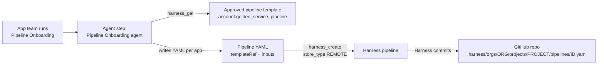

# Self-Service Pipeline Onboarding with a Harness AI Agent

App teams get a production-ready pipeline in minutes by running one onboarding pipeline. The platform team owns the pipeline template and the guardrails. An AI agent builds each team's pipeline from the approved template, then creates it in Harness and commits its YAML to GitHub.

## How it works

1. An app team runs **Pipeline Onboarding** with their team name, a list of applications and a few settings.
2. The **Pipeline Onboarding agent** reads the approved template through the Harness MCP server and finds its runtime inputs.
3. For each application, the agent writes a pipeline YAML that references the template and fills every input. It checks each value against the template's allowed values and regex rules.
4. The agent creates each pipeline with Harness Git Experience, so one call creates the pipeline in Harness and commits the YAML to GitHub.
5. The agent prints a report with one status per pipeline (`CREATED`, `SKIPPED`, `WOULD_CREATE` or `FAILED`) and links to Harness and GitHub.

Who owns what:

| Role | Owns |
|---|---|
| Platform team | The pipeline template, the agent, the onboarding pipeline, the connectors and where pipelines are stored |
| App teams | Running the onboarding pipeline with their team, applications and settings |

## Components

| File | What it is | Harness object |
|---|---|---|
| `templates/golden_service_pipeline_v1.yaml` | The approved pipeline template, with 4 stages and 11 runtime inputs | Account-level Pipeline template `golden_service_pipeline`, version `v1` |
| `agent/pipeline_onboarding_agent.yaml` | The AI agent: its prompt, model connector, MCP server and inputs | Agent `pipeline_onboarding_agent` (Harness saves it as `ca_pipeline_onboarding_agent`) |
| `pipelines/pipeline_onboarding.yaml` | The self-service pipeline app teams run: one CI stage with one Agent step | Pipeline `pipeline_onboarding` |
| `examples/payments_orders_api.yaml` | Example of a pipeline the agent generates | Reference only |

### The template: `golden_service_pipeline`

| Stage | What it does |
|---|---|
| Build and Test | Resolves the version, compiles, and runs unit tests with a JUnit report and a coverage gate |
| Quality and Security | Runs lint, SAST and dependency scans in parallel, then a quality gate on critical findings |
| Package and Publish | Builds the container image, generates a CycloneDX SBOM and publishes |
| Deploy | Renders manifests, does a rolling deploy and runs a smoke test with retry. Only runs when `deploy` is `true` |

Runtime inputs:
- `app_name`, `team`, `language`
- `version_prefix`, `coverage_threshold`, `security_scan`, `max_critical_findings`
- `image_registry`, `deploy`, `environment`, `docker_connector`

The template is a working demo: its steps simulate a real build with shell commands. Replace the step commands with your real build, scan and deploy tooling. The onboarding flow doesn't change.

## Prerequisites

### Harness features

- [ ] **Harness AI agents** enabled on the account, so the **Agent** step type and the Agents page are available.
- [ ] **CI module**, to run the onboarding stage.
- [ ] **Git Experience**, for pipelines stored in GitHub.

### Connectors and access

| # | Prerequisite | Why | Example (demo account) |
|---|---|---|---|
| 1 | **LLM connector** for the agent's model | The agent runs on it | `account.harnessAnthropic`, model `claude-opus-5-5` |
| 2 | **Harness MCP connector** pointing to the Harness MCP server, authenticated with a service account API key | The agent reads templates and creates pipelines through it | `mcpconnector` → `https://app.harness.io/prod1/mcp-server-external/mcp` |
| 3 | **GitHub connector** with API access enabled and a token that can **write** to the target repo | Harness commits the pipeline YAML through it | `harnesstesting` |
| 4 | **GitHub repository and branch** for pipeline YAML files | Where onboarded pipelines are stored | repo `pipelines`, branch `main` |
| 5 | **Docker registry connector**, used by the template's steps to pull images | Step images in the created pipelines | `account.dockerhub` |
| 6 | **Build infrastructure** for the onboarding stage | Runs the Agent step | Harness Cloud, or a Kubernetes cluster (see the Workday notes) |

Permissions for the MCP connector's service account:

| Permission | Scope |
|---|---|
| Templates: View | Where the template lives (account) |
| Pipelines: View and Create/Edit | Every org and project that app teams can onboard into |
| Connectors: View and Access | The GitHub connector |

Give it nothing more. The agent's prompt allows only pipeline creation. Least privilege enforces that on the Harness side.

In the MCP connector's tool settings, set `harness_create` to **Allowed** and `harness_update` / `harness_delete` to **Needs approval** or **Blocked**.

Check the GitHub connector before you start: in the connector's page, **Test connection** must succeed, and listing repositories must work. A connector can show *Success* from an old test while its token has expired.

### Workday-specific notes

- **Build infrastructure:** Workday policy requires the CI namespace to match the project's `k8s_namespace` tag (error) and the Kubernetes connector to be org- or account-scoped (warning). If you don't use Harness Cloud, change the onboarding stage's `runtime` to your Kubernetes infrastructure with a compliant namespace and connector. Do the same in the template's stages.
- **Template location:** keep the template at account level, or org level, so every project can use it. Pass the scoped reference, for example `account.golden_service_pipeline` or `org.golden_service_pipeline`.
- **Harness URL:** pipeline links in the agent's report use `app.harness.io`. Workday's account is on `app3.harness.io`, so change that host in the agent prompt's report step.
- **Images:** if public Docker Hub is blocked, point `docker_connector` and the step images at Artifactory.

## Setup (platform team, one time)

1. **Create the template.**
   - Account Settings → Templates → New Template → Pipeline.
   - Paste `templates/golden_service_pipeline_v1.yaml`, set version `v1` and mark it stable.
   - Adjust stage infrastructure and step images for your environment first.
2. **Create the agent.**
   - Project → Agents → New Agent.
   - Paste `agent/pipeline_onboarding_agent.yaml` and save.
   - Note the identifier Harness gives it. It adds a `ca_` prefix, for example `ca_pipeline_onboarding_agent`.
   - Mark the version stable. Each save is a new version, and the pipeline uses the stable one.
   - Check these values in the agent YAML:
     - `connector`: your LLM connector.
     - `mcp`: your MCP connector.
     - `env.ANTHROPIC_MODEL`: the model to use.
     - `inputs.gitConnector`, `gitRepo`, `gitBranch`: the defaults for where pipelines are stored.
3. **Create the onboarding pipeline.**
   - Paste `pipelines/pipeline_onboarding.yaml` into a new pipeline. Set `orgIdentifier` and `projectIdentifier` to the project that hosts it.
   - Set `agentName` to the agent identifier from step 2.
   - Set `agentSettings` to your GitHub connector, repo and branch.
   - Update the `allowedValues` of `template_ref` and `template_version` when you publish new templates or versions.
4. **Check that it works.**
   - Run once with `dry_run=true`.
   - In the Agent step log you should see the template inputs, the generated YAML and `WOULD_CREATE`.
   - Then run with `dry_run=false` for a test app.
   - Confirm the pipeline appears in Harness and its YAML file is committed in GitHub.
5. **Share it with app teams.** Give them Execute permission on the onboarding pipeline only. They don't need permission to create pipelines themselves.

## Using it (app teams)

1. Open **Pipeline Onboarding** and click **Run**.
2. Fill in the inputs:

   | Input | Example | Notes |
   |---|---|---|
   | `team` | `payments` | Lowercase letters, digits and dashes |
   | `apps` | `orders-api:java,payments-api:go` | Comma-separated. Add `:language` per app, or leave it off to use `default_language` |
   | `default_language` | `java` | `java`, `go`, `node` or `python` |
   | `target_org` / `target_project` | `testprameet` / `testproj` | Where your pipelines are created |
   | `template_ref` / `template_version` | `account.golden_service_pipeline` / `v1` | Picked from the approved list |
   | `version_prefix` | `1.0` | Major.minor for build versions |
   | `coverage_threshold` | `80` | Minimum unit-test coverage, in percent |
   | `security_scan` | `true` | Runs the SAST and dependency scans |
   | `max_critical_findings` | `0` | Critical findings allowed before the quality gate fails |
   | `image_registry` | `registry.example.com` | Where images are published |
   | `deploy` / `environment` | `true` / `dev` | Whether to deploy, and where |
   | `docker_connector` | `account.dockerhub` | Image pull connector for your pipelines |
   | `dry_run` | `true` | Preview first. Set `false` to create |

3. Run with `dry_run=true` and read the report in the **Onboard Pipelines - AI** step log. Fix any `FAILED` rows.
4. Run again with `dry_run=false`. Each application gets:
   - a pipeline named after the app, with identifier `<team>_<app>` (dashes become underscores), for example `payments_orders_api`;
   - a YAML file at `.harness/orgs/<org>/projects/<project>/pipelines/<identifier>.yaml` in the platform team's GitHub repo;
   - tags `team`, `language` and `onboarded-by: pipeline-onboarding`.
5. Run your new pipeline. Changes go through the template: ask the platform team for a new template version rather than editing your pipeline.

Re-running is safe. Pipelines that already exist are reported as `SKIPPED` and never changed.

## Guardrails

- **Writes:** the only write the agent may make is `harness_create` for pipelines, stored in Git. It must never update, delete, import or execute anything, or create any other kind of resource.
- **Template inputs:** pipelines always reference the approved template and version. The agent fills the template's inputs and doesn't invent or change anything else.
- **Validation:** every value is checked against the template's own allowed values and regex rules before anything is created.
- **Idempotency:** existing pipelines are skipped, and an existing file in GitHub is reported, never overwritten.
- **Dry run:** the default is `dry_run=true`, so nothing is created until a team asks for it.
- **Least privilege:** the MCP service account's permissions and the MCP connector's tool settings enforce the same limits in Harness.

## Updating and extending

- **New template version:** publish `v2` of the template, add `v2` to the pipeline's `template_version` allowed values, then mark `v2` stable when it's ready. Existing pipelines stay on the version they reference until moved.
- **New template:** add its reference to `template_ref` allowed values. If it has inputs other than `app_name`, `team` and `language`:
  - add a pipeline variable for each one;
  - add `name=<+pipeline.variables.name>` to the `TEMPLATE_VALUES` line in the agent prompt.
- **Agent changes:** edit the YAML, save it as a new version and mark it stable.

## Troubleshooting

| Symptom | Cause and fix |
|---|---|
| Agent step fails at once with **"Null Pointer Exception"** and has no log | Harness failed to expand the agent before it started. Two known causes:  • **Modifier syntax in the prompt:** don't write `.default()`, `.allowedValues()` or `.regex()` in the prompt, even as text.  • **Unsupported `agentSettings`:** keep them literal values.  Run values reach the prompt through `<+pipeline.variables.*>`. |
| Agent reports a missing plan or old behaviour | The pipeline is using an old agent version. Mark the latest version stable, or check `agentName`. |
| `Agent not found` | `agentName` must match the saved identifier, including the `ca_` prefix. |
| `FAILED: template not found` | Wrong `template_ref` scope prefix or version, or the MCP service account can't view templates. |
| Create fails with `Bad credentials` or a Git error | The GitHub connector token has expired or can't write to the repo. Fix the connector and test listing repos. |
| Create fails with a permission error | The MCP service account lacks Pipeline Create/Edit in the target project. |
| `FAILED: file already exists` | A YAML file is already at that path in GitHub. Remove it, or import it into Harness yourself. |
| Run steps in created pipelines can't pull images | `docker_connector` doesn't exist or can't reach the registry. |

## Status

Validated in the Harness demo account (`testprameet/testproj`):
- **Dry run:** completed end to end. It read the template, validated all 11 inputs, generated the correct pipeline YAML, checked existence, and reported `WOULD_CREATE`. That took about 10 agent turns and about $0.70 per run.
- **Create path:** Git-backed create through the MCP server, using `store_type REMOTE` with `connector_ref`, `repo_name`, `branch`, `file_path` and `commit_msg`. Confirm it in your account with a test app before rolling out.
